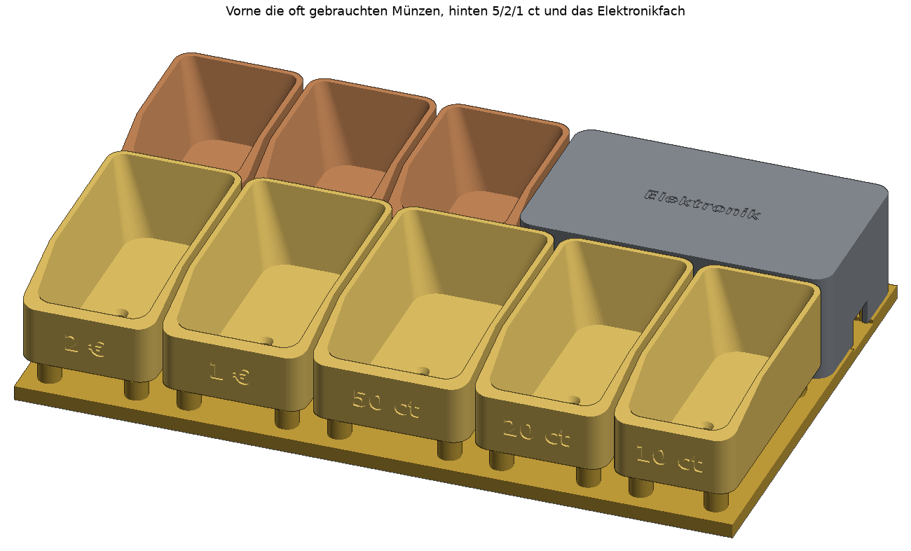
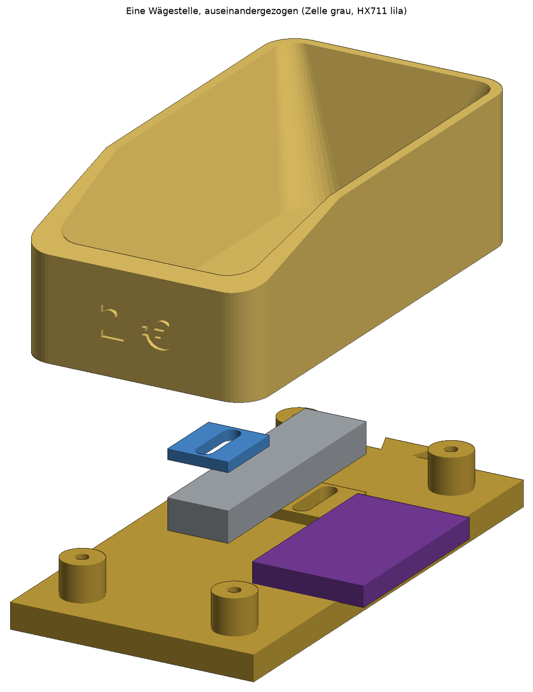

# Münzwaage für die Kasse

Acht Münzmulden (2 € bis 1 ct), jede auf einer eigenen Wägezelle. Ein ESP32 liest alle acht
Waagen und meldet der Kasse, wie viel Geld in welcher Mulde liegt. Weil die Waage zählt, liegen
die Münzen lose in der Mulde – kein Stapeln, schneller Zugriff beim Wechselgeld. Bei unsicheren
Einsortierungen (z. B. 1 € gegen 50 ct) fordert die App zum Nachsehen auf.




```
hinten (62 mm tief):  5 ct (44)  2 ct (44)  1 ct (44)  [ Elektronikfach (108) ]
vorne  (90 mm tief):  2 € (46)  1 € (50)  50 ct (54)  20 ct (46)  10 ct (42)
```

Vorne, direkt an der Hand, liegen die fünf oft gebrauchten Münzen in großen Mulden.
5 ct, 2 ct und 1 ct braucht man fast nie: sie sind klein und hinten. Daneben sitzt das
Elektronikfach mit dem ESP32 unter einem Deckel (oben bündig, abnehmbar).

Gesamtmaß: **248 × 156 mm, 43 mm hoch.**

## Teile

| Teil | Datei | Anzahl |
|---|---|---|
| Grundplatte hinten (mit Elektronikfach) | `stl/grundplatte_hinten.stl` | 1 |
| Grundplatte vorne | `stl/grundplatte_vorne.stl` | 1 |
| Mulde, beschriftet | `stl/mulde_*.stl` | je 1 |
| Deckel Elektronikfach (kopfüber drucken) | `stl/deckel_elektronik.stl` | 1 |
| Abstandshalter | `stl/abstandshalter.stl` | 8 |

- Die Wägezelle wird mit ihrem **festen Ende** (hinten) von unten auf den Sockel geschraubt.
- Auf das **freie Ende** (vorne) kommt der Abstandshalter, darauf die Mulde (Senkkopfschrauben von innen).
- Die Mulde hängt nur an der Zelle und berührt sonst nichts: 2 mm Luft zur Nachbarmulde,
  2 mm über dem festen Zellenende, 2 mm unter dem freien Ende.
- **Vier Anschlag-Schrauben** pro Mulde (M3×10, von unten in die Pfosten gedreht) fangen sie ab,
  wenn jemand fest hineindrückt. So kann die Zelle nicht überlastet werden.
- Der ESP32 liegt im Elektronikfach, USB-C zeigt nach rechts aus dem Gerät. Die HX711 werden
  mit Klebepads auf eine freie Stelle unter der jeweiligen Mulde geklebt (nicht auf Pfosten oder Zelle).
- Die beiden Grundplatten werden mit den Schwalbenschwänzen zusammengesteckt.

## Maße anpassen

Die Standardwerte sind Annahmen. Oben in `generate.py` anpassen und neu erzeugen:

- `LAYOUT` – welche Münze in welcher Reihe, Breite jeder Mulde und Tiefe jeder Reihe. Beide Reihen
  müssen zusammen gleich breit sein, jede Mulde mindestens 42 mm breit.
- `BOWL_H` – Höhe der Mulden (z. B. niedriger, wenn die Kassenschublade flach ist)
- `CLAMP_LEN`, `SCREW_SLOT` – Länge des massiven Endblocks der Wägezelle und Lage der Gewindelöcher.
  Sockel und Abstandshalter dürfen **nur unter bzw. auf dem Endblock** liegen, nicht am dünnen Mittelteil.

```sh
python3 -m venv .venv && .venv/bin/pip install manifold3d numpy matplotlib
.venv/bin/python generate.py
```

## Druck

PETG (kriecht weniger als PLA unter Dauerlast), 0,2 mm Schicht, 3 Wände, 15–20 % Füllung, ohne Stützen.
Alle Teile liegen so, wie sie exportiert sind. Die Grundplatten brauchen ein Druckbett ab 250 mm.

## Einkaufsliste

| Teil | Menge | Hinweis |
|---|---|---|
| Mini-Wägezelle 47×12×6 mm, **500 g** | 5 (4 + 1 Ersatz) | 2 €, 1 €, 50 ct, 20 ct |
| Mini-Wägezelle 47×12×6 mm, **300 g** | 5 (4 + 1 Ersatz) | 10 ct, 5 ct, 2 ct, 1 ct |
| HX711-Modul | 1 Pack à 10 | |
| ESP32-C3 SuperMini | 2 (1 Ersatz) | |
| Schraube M3×10, Zylinderkopf (DIN 912) | 1 Pack à 50 | 6 pro Mulde = 48 |
| Schraube M3×10, Senkkopf (DIN 7991) | 1 Pack à 20 | 2 pro Mulde = 16 |
| Silikonlitze 26 AWG (mehrere Farben) | 1 Set | HX711 → ESP32 |
| Doppelseitige Klebepads | 1 Pack | |

Gewicht einer vollen Mulde mit 50 Münzen: 2 € 425 g, 1 € 375 g, 50 ct 390 g, 20 ct 287 g –
deshalb 500 g. Die kleinen Münzen bleiben unter 210 g, dafür reicht 300 g (genauer).

## Verdrahtung

Wägezelle → HX711: Rot = E+, Schwarz = E−, Grün (oder Blau) = A+, Weiß = A−.

Alle HX711 teilen sich **eine Taktleitung (SCK an GPIO 10)**, jede hat ihre eigene Datenleitung.
Die Firmware liest alle acht gleichzeitig.

| Mulde | HX711 DT |
|---|---|
| 2 € | GPIO 0 |
| 1 € | GPIO 1 |
| 50 ct | GPIO 3 |
| 20 ct | GPIO 4 |
| 10 ct | GPIO 5 |
| 5 ct | GPIO 6 |
| 2 ct | GPIO 7 |
| 1 ct | GPIO 20 |

Alle HX711: VCC an 3V3, GND an GND. GPIO 2, 8 und 9 bleiben frei (Startpins des ESP32-C3).

## Anschläge einstellen

1. Alles montieren, die Firmware zeigt die Live-Werte.
2. Anschlag-Schraube von unten hochdrehen, bis sich der Messwert bewegt (sie berührt die Mulde).
3. Eine halbe bis ganze Umdrehung zurück: 0,25–0,5 mm Luft.
